<p align="center">
  <a href="https://portfolio-tausif.vercel.app/"></a>
</p>

<p align="center">
  <a href="https://portfolio-tausif.vercel.app/"></a>
  <a href="https://www.linkedin.com/in/tausifansari2907"></a>
  <a href="mailto:tausifansari2907@gmail.com"></a>
</p>


## ⚡ About Me

I'm a **B.Tech Computer Science** student at **REVA University, Bangalore**, with hands-on experience building **scalable web applications** and **intelligent automation systems**. I specialise in modern web development with **React** and love creating tools that solve real-world operational problems.

**🔭 What I'm focused on right now**

- 🧩 Architecting custom **CRM dashboards** and premium **digital storefronts**
- 🤖 Automating workflows with tools like the **WhatsApp Cloud API**
- 🕸️ Building robust **web scrapers** for efficient lead generation
- 🧠 Exploring **AI-powered systems**, **agentic workflows** and **MCP servers**
- 🎨 Blending **clean UI** with **complex data systems**

```ts
const tausif = {
  role: "Full-Stack Developer",
  education: "B.Tech CSE @ REVA University",
  basedIn: "Bangalore, India",
  workflow: ["Design", "Develop", "Deploy"],
  exploring: ["Agentic workflows", "MCP servers", "RAG pipelines"],
  openTo: ["Opportunities", "Collaborations", "New ideas"],
};
```


## 🧰 Tech Stack

<h4 align="center">💻 Languages</h4>
<p align="center">
  
  
  
  
  
  
  
</p>

<h4 align="center">🎨 Frontend & Mobile</h4>
<p align="center">
  
  
  
  
  
  
  
</p>

<h4 align="center">⚙️ Backend</h4>
<p align="center">
  
  
  
  
  
  
  
</p>

<h4 align="center">🗄️ Databases & ORMs</h4>
<p align="center">
  
  
  
  
  
  
</p>

<h4 align="center">🤖 AI & Data</h4>
<p align="center">
  
  
  
  
  
  
  
  
</p>

<h4 align="center">🕸️ Automation & Scraping</h4>
<p align="center">
  
  
  
  
</p>

<h4 align="center">🛠️ Tools & Platforms</h4>
<p align="center">
  
  
  
  
  
  
  
  
  
</p>


## 🚀 Featured Projects

<table>
  <tr>
    <td width="50%" valign="top">
      <h3>📍 Hyper-Local Lead Generation SaaS</h3>
      <p>Finds local businesses with a weak online presence, audits them and turns them into scored, ready-to-pitch sales leads.</p>
      <ul>
        <li>🗺️ Scrapes Google Maps by niche + city</li>
        <li>🔍 Audits every website: speed, mobile-readiness, booking, CMS</li>
        <li>📊 Scores leads 0–100 and skips duplicates automatically</li>
        <li>✍️ AI-written call scripts, cold emails &amp; follow-ups</li>
        <li>🗂️ Drag-and-drop Kanban pipeline with CSV export</li>
      </ul>
      <p><code>Python</code> <code>Playwright</code> <code>Next.js</code> <code>TypeScript</code> <code>Tailwind</code> <code>Prisma</code> <code>PostgreSQL</code> <code>OpenAI</code></p>
      <p><a href="https://github.com/tausif2907/Hyper-Local-Lead-Generation-SaaS"></a></p>
    </td>
    <td width="50%" valign="top">
      <h3>🎧 VedaVerse</h3>
      <p>An AI-powered, voice-first learning platform built for blind and visually impaired learners.</p>
      <ul>
        <li>🎙️ Voice input in English, Hindi &amp; Kannada</li>
        <li>📄 Ask questions about any PDF with RAG</li>
        <li>🔊 Converts full PDFs into audiobooks</li>
        <li>📝 Auto-generated quizzes with instant feedback</li>
        <li>✏️ Sketchpad that solves handwritten math, physics &amp; chemistry problems</li>
      </ul>
      <p><code>Python</code> <code>Django</code> <code>LangChain</code> <code>OpenAI</code> <code>Gemini</code> <code>ChromaDB</code> <code>gTTS</code></p>
      <p><a href="https://github.com/tausif2907/VedaVerse"></a></p>
    </td>
  </tr>
</table>

<p align="center">
  <a href="https://portfolio-tausif.vercel.app/"><b>✨ See more of my work on my portfolio →</b></a>
</p>


## 🤝 Let's Connect

<p align="center">
  <i>“Opportunities, collaborations, or ideas — let's connect and build forward.”</i>
</p>

<p align="center">
  <a href="https://portfolio-tausif.vercel.app/"></a>
  <a href="https://www.linkedin.com/in/tausifansari2907"></a>
  <a href="mailto:tausifansari2907@gmail.com"></a>
</p>

<p align="center">
  
</p>
